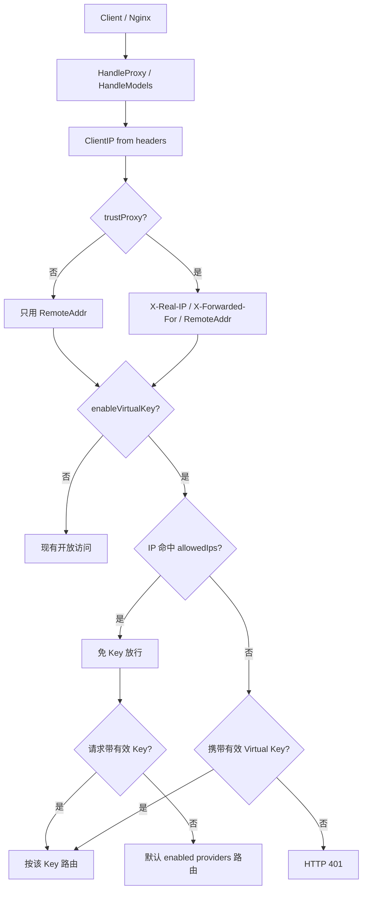
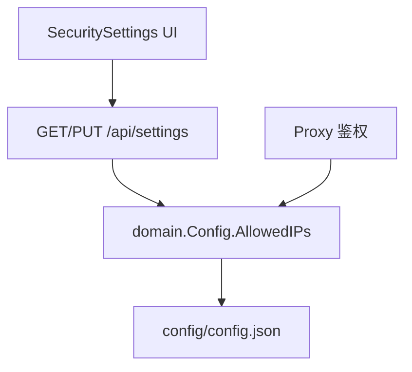

# Global IP Whitelist for Virtual Key Gate

Feature Name: key-ip-whitelist
Updated: 2026-10-23

## Description

在 `enableVirtualKey` 开启时增加一份全局 IP 白名单（`allowedIps`）。白名单与单个 Virtual Key 无关：真实客户端 IP 命中列表（精确 IP 或 CIDR）时免 Key 放行；列表为空或未命中时必须携带有效 Virtual Key。默认 `trustProxy=false`，只用 TCP 对端地址（容器直连即该地址）。开启后才采信 `X-Real-IP` / `X-Forwarded-For`。管理端通过 Settings API 读写该列表与开关。

## Architecture





鉴权顺序固定为：全局开关 -> IP 白名单命中则免 Key -> 否则走现有 Virtual Key 校验。IP 解析与白名单匹配抽成独立函数，供 `/v1/*` 代理与 `/v1/models` 共用，避免两处逻辑分叉。

## Components and Interfaces

### 1. domain 层（internal/domain/domain.go）

`Config` 与 `Settings` 新增顶层字段：

```go
AllowedIPs []string `json:"allowedIps,omitempty"`
TrustProxy bool     `json:"trustProxy"`
```

`ToSettings()` 原样带出上述字段。旧配置缺少时 `allowedIps` 视为空切片，`trustProxy` 视为 false。

### 2. 真实 IP 与白名单匹配（internal/auth/auth.go）

新增纯函数，无状态、便于单测：

- `ClientIP(r *http.Request, trustProxy bool) string`
  - `trustProxy=false`：只用 TCP 对端（`SplitHostPort(RemoteAddr)`）
  - `trustProxy=true`：优先 `X-Real-IP`，否则 `X-Forwarded-For` 最左合法 IP，否则 RemoteAddr
  - IPv4-mapped IPv6 规范化为 IPv4 字符串（`ip.To4()`）
- `IPAllowed(ip string, cidrs []string) bool`
  - `cidrs` 为空返回 false（空名单不构成免 Key 条件）
  - 每条先尝试 `net.ParseCIDR`，失败则当作精确 IP（`net.ParseIP`）比较
  - 非法条目跳过，不匹配
- `NormalizeAllowedIPs(items []string) ([]string, error)`
  - trim、去空行；每条必须是合法 IP 或 CIDR，否则返回错误
  - 精确 IP 规范化为标准字符串；CIDR 保留网络形式

### 3. 代理鉴权（internal/proxy/app.go、internal/proxy/models.go）

抽出共享函数 `authorizeVirtualKey(cfg, apiKey, clientIP) (matchedKey bool, bypassByIP bool)`：

| enableVirtualKey | IP 命中白名单 | Key 匹配 | 结果 |
|---|---|---|---|
| false | * | * | 放行（现有开放访问） |
| true | 是 | 是 | 放行，按该 Key 路由 |
| true | 是 | 否 | 放行，默认 enabled providers |
| true | 否（含空名单） | 是 | 放行，按该 Key 路由 |
| true | 否（含空名单） | 否 | 401，现有错误文案 |

`len(cfg.Keys) == 0` 的现有兜底（warn 后放行）保持不变，仅在「未因 IP 放行且 Key 未匹配」时生效。

`HandleProxy` 与 `HandleModels` 在现有 Virtual Key 校验处改为调用该函数。`selectCandidates` 仍只认 apiKey，IP 旁路不伪造 Key。

拒绝时记录代理日志，包含解析出的 client IP（不记录完整 Key）。

### 4. Settings API（internal/handlers/handlers.go、internal/config/config.go）

- `rawConfig` 增加 `AllowedIPs []string json:"allowedIps"`
- `mergeConfig` 在 JSON 出现 `allowedIps` 时覆盖（含显式空数组）
- `HandleUpdateSettings` 增加 `AllowedIps *[]string` 与 `TrustProxy *bool`；`allowedIps` 非 nil 时经 `NormalizeAllowedIPs` 写入，非法返回 400
- `HandleGetSettings` 通过 `ToSettings` 返回 `allowedIps` 与 `trustProxy`
- `validate` 对已加载的 `allowedIps` 再跑一遍规范化；非法条目导致启动失败

### 5. 前端（src/types.ts、src/components/SecuritySettings.tsx、src/App.tsx）

`Settings` 增加 `allowedIps?: string[]` 与 `trustProxy?: boolean`。Security Settings 的 Virtual Key 卡片内增加 Trust Proxy 开关与多行文本框（每行一条 IP/CIDR），保存走现有 `PUT /api/settings`。文案说明：名单内 IP 免 Key；空名单则开启 Gate 后必须带 Key。Trust Proxy 关闭时只用 TCP 对端。Docker 桥接 + 端口映射时对端是网关（常见 `172.17.0.1`），不能按公网客户端做白名单；同网桥容器互访可白名单对端容器 IP。要按真实客户端匹配：改 `network_mode: host`，或在宿主机/host 网络放 Nginx 写 `X-Real-IP` 并打开 Trust Proxy。不要把网关 IP 当真实客户端写入白名单。

## Data Models

config.json 顶层：

```json
{
  "enableVirtualKey": true,
  "allowedIps": ["127.0.0.1", "10.0.0.0/8", "2001:db8::/32"]
}
```

Settings API 响应同样包含 `allowedIps`。空数组与缺省字段语义相同：无免 Key IP。

## Correctness Properties

- `trustProxy=false` 时忽略转发头，只用 RemoteAddr；`true` 时优先级固定：`X-Real-IP` > `X-Forwarded-For` 最左合法项 > `RemoteAddr`。
- 空 `allowedIps` 在 `enableVirtualKey=true` 时不产生免 Key 路径。
- 白名单命中只跳过 Key 校验，不改变已匹配 Key 的 Group / providerIds 路由。
- IPv4-mapped IPv6 与对应 IPv4 白名单条目互相命中。
- CIDR 按地址族匹配：IPv4 只进 IPv4 网段，IPv6 只进 IPv6 网段。
- 非法白名单条目在保存/启动时拒绝，运行时匹配跳过非法项。

## Error Handling

| 场景 | 行为 |
|---|---|
| Gate 开启、IP 未命中、Key 无效/缺失 | HTTP 401，现有 `Unauthorized: Invalid or missing virtual key` |
| `PUT /api/settings` 含非法 IP/CIDR | HTTP 400，错误信息指出非法条目 |
| 启动时 config.json 含非法 `allowedIps` | `validate` 失败，进程拒绝启动 |
| 转发头全是垃圾值 | 回退 RemoteAddr；仍未命中则走 Key 校验 |
| Keys 列表为空且 Gate 开启 | 保持现有 warn + 放行 |

## Test Strategy

1. **auth 单元测试**
   - ClientIP：X-Real-IP 优先；XFF 取最左合法 IP；RemoteAddr 去端口；`::ffff:1.2.3.4` 规范化。
   - IPAllowed：精确命中、CIDR 包含/不包含、空列表 false、IPv4 vs IPv6 不串族、非法条目跳过。
   - NormalizeAllowedIPs：去空白、拒绝非法、保留合法 CIDR。

2. **proxy 鉴权测试**
   - Gate 关：无 Key 200。
   - Gate 开 + 空白名单 + 无 Key：401。
   - Gate 开 + 空白名单 + 有效 Key：200。
   - Gate 开 + IP 命中 + 无 Key：200（默认路由）。
   - Gate 开 + IP 命中 + 有效 Key：200 且按该 Key 的 provider 绑定。
   - Gate 开 + X-Real-IP 命中 / 仅 XFF 命中 / 仅 RemoteAddr 命中。
   - `/v1/models` 与 `/v1/chat/completions` 行为一致。

3. **handlers / config**
   - PUT settings 写入 `allowedIps`；非法条目 400。
   - 缺字段的旧 config.json 可加载，AllowedIPs 为空。

## References

- 当前工作区 `/internal/proxy/app.go` Virtual Key 校验
- 当前工作区 `/internal/proxy/models.go` `/v1/models` 鉴权
- 当前工作区 `/internal/domain/domain.go` Config / Settings
- 当前工作区 `/internal/handlers/handlers.go` Settings API
- RFC 7239 / 常见 Nginx `proxy_set_header X-Real-IP $remote_addr;` 与 `X-Forwarded-For`
